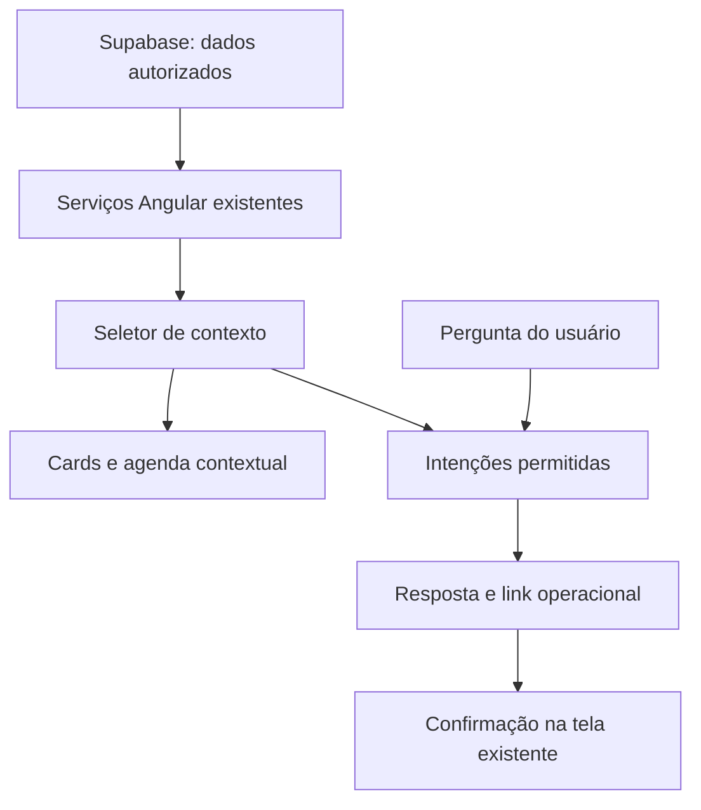

# AgendaAI contextual — arquitetura e implantação incremental

## Objetivo

Transformar a área autenticada do estabelecimento em uma experiência orientada por contexto, sem substituir os fluxos transacionais existentes (agenda, serviços, caixa, comanda, comissões, cobrança, Growth e configurações).

## Primeira entrega: home contextual, somente leitura

- Rota principal: `/admin/dashboard` carrega `ContextHome`.
- Rota de contingência: `/admin/dashboard-classico` mantém a home anterior sem alterações.
- Fontes: `AgendaEventService.events$`, `ClienteService.clientes$`, `EstabelecimentoService.activeId$`, `AuthService.profile$`, com assinaturas liberadas ao sair da tela.
- Motor determinístico: `src/app/core/contextual-home.ts`. Ele resume os eventos do dia, prioriza conferências, sugere o próximo atendimento e resolve um conjunto limitado de solicitações de navegação.
- O formulário conversacional **não executa mutações**. Agendamentos, pagamentos, campanhas e comissões continuam nas telas existentes e exigem a revisão habitual.
- O valor mensal exibido em uma consulta é a soma **prevista nos agendamentos**, não faturamento recebido. Para valores realizados, a resposta direciona aos relatórios financeiros.
- A interface usa componentes Angular e CSS locais, sem geração arbitrária de HTML, scripts ou rotas a partir de modelos.
- A conversa em memória é descartada ao mudar de unidade. O resultado renderizado provém do contexto da unidade acessível conforme as permissões existentes.

## Fluxo atual

## Próximas entregas propostas

1. **Contexto mais amplo:** indicadores de pagamentos efetivamente liquidados, ocupação baseada nos horários reais, tendências por profissional, cancelamentos e retenção. Criar consultas/visões eficientes com isolamento por unidade e RLS antes de incorporar novos números ao assistente.
2. **Interpretação por IA:** serviço autenticado no backend com Vercel AI Gateway e esquema tipado de intenções/cards; somente leitura, com limites de orçamento, rate limiting, observabilidade e fallback determinístico. Não enviar dados pessoais ou financeiros indiscriminadamente ao modelo.
3. **Ações autorizadas:** cada ferramenta com checagem de papel e unidade **no servidor**, idempotência, prévia explícita, confirmação humana para alteração de reservas, campanhas, preços ou pagamentos e trilha de auditoria. Nenhum modelo acessa Supabase via service role sem autorização específica por operação.
4. **Interface adaptativa:** cards e controles de um catálogo tipado (agenda, comparação, evolução financeira, cliente, comanda) em vez de HTML gerado livremente. A mesma base poderá alimentar o mobile/PWA e, com dados demonstrativos isolados, a experiência comercial.

## Garantias de compatibilidade

- Não foram criadas tabelas ou migrations; a segurança e o modelo de tenancy continuam os existentes.
- Não houve alteração das rotas operacionais, guardas, checkout ou integração Stripe.
- A home anterior continua disponível durante o amadurecimento do produto.
- Novas respostas e ações devem ter testes cobrindo ambiguidade da intenção, permissões, troca de unidade, estados de carregamento, indisponibilidade do backend e ausência de dados.
