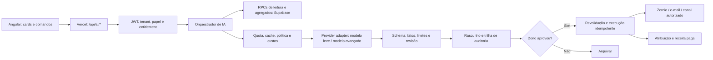

# AgendaAI Intelligence — PRD e arquitetura de IA

**Estado:** especificação de produto / não implementado. **Referência:** branch do piloto de preços com Agenda R$ 79, Gestão R$ 119 e Growth R$ 169 (prévia).  
**Objetivo:** entregar inteligência acionável e mensurável para pequenos negócios de beleza, sem transformar o produto em um chatbot genérico ou expor operações sensíveis a modelos.

## 1. Princípios de produto

1. **Valor antes de IA.** Cada recurso responde a uma pergunta operacional, apresenta evidências e um próximo passo. Não rotular regras estáticas como modelos generativos.
2. **Dados de fonte identificável.** Valores monetários, horários, serviços, disponibilidade e comissões vêm de banco/RPCs confiáveis; nunca de geração de texto.
3. **Ações graduais.** Primeiro observar, depois propor, por último executar com autorização humana e validação transacional; por padrão não enviar mensagens, alterar preços, cobranças ou agenda automaticamente.
4. **Mesma experiência para todos.** Agenda R$ 79 tem assistência gratuita de baixo custo; Gestão R$ 119 ganha análises de operação; Growth IA R$ 169 ganha recomendações e campanhas guiadas por dados.
5. **Sem taxa por agenda adicional.** Uso proporcional a créditos de IA/integrações, com franquia transparente, não por profissional.
6. **Sem promessas não comprovadas.** “Agendamento atribuído” não é receita paga nem incremento causado por campanha.

## 2. Posicionamento comercial e entitlements

| Capacidade | Agenda · R$ 79 | Gestão · R$ 119 | Growth IA · R$ 169 |
|---|---|---|---|
| Ajuda contextual e busca de serviços/horários | Incluído | Incluído | Incluído |
| Comandos de agenda em linguagem natural | Prévia confirmatória | Prévia confirmatória | Prévia confirmatória |
| Resumo diário/semana com indicadores reais | Básico | Completo | Completo |
| Alertas operacionais: faltas/ocupaçao/anomalias | Básico (regras) | Avançado, baseado em dados | Avançado |
| Oportunidades comercialmente priorizadas | — | Prévia limitada | Sim |
| Campanhas personalizadas por IA | — | — | Sim, em rascunho |
| Reativação consentida por segmentos | — | Listas/regras básicas | Segmentação priorizada + rascunhos |
| Integração social Zernio | Manual, se existente | Manual, se existente | Preparação assistida, publicação aprovada; franquia separada |
| Atribuição visita → reserva → recebimento | Relatório básico | Relatório básico | Comparação por campanha / coorte |
| Atendimento automatizado por mensagens | Não incluído | Não incluído | Futuro add-on, condicionado a provedor e custo |

**Atenção:** tabela é objetivo e não uma afirmação de gates já existentes. Antes de vender diferenciação, instalar verificação de entitlement no backend para TODO endpoint; o frontend pode apenas apresentar a experiência. Growth IA permanece `preview` no catálogo e não pode gerar checkout até validação técnica, jurídica e comercial. Planos legados mantêm acesso contratado. Empacotamento anterior de módulos extras deve ser revisado para evitar cobrar duas vezes por funcionalidades já incluídas no Growth IA.

### Franquias iniciais para piloto (não anunciadas antes de benchmark de custos)
- Agenda: assistência contextual com regras; geração por modelo somente em operações limitadas e mensuradas.
- Gestão: 20 resumos/insights assistidos por mês como limite *proposto* (ajustar após observar consumo).
- Growth IA: 30 análises e 8 rascunhos de campanha por mês, por estabelecimento; publicações e mensagens cobradas/limitadas conforme provedor.
- Nunca converter tokens diretamente em marketing de produto; mostrar “análises” e “campanhas” com definições claras, status e período.

## 3. Fluxo-chave: preencher horários ociosos com rentabilidade

**Trigger**: evento de agenda e agenda de horas vagas real, em janela futura, calculado pelo serviço de disponibilidade.  
**Cálculo determinístico**: identificar janelas realmente disponíveis, profissionais e serviços elegíveis, taxa de ocupação em janela comparável, receita histórica confirmada por atendimento quando disponível, custos prováveis e nível de confiança.  
**Priorização**: considerar quantidade de horários recuperáveis, valor estimado por atendimento confirmado, probabilidade baseada em histórico se amostra suficiente, fadiga de campanhas e margem de desconto. Se amostra insuficiente, usar heurística marcada.  
**Geração**: modelo recebe somente fatos e contexto de marca: serviço, janela, profissional, link rastreável, restrições, não a base completa de clientes. Produz proposta estruturada: título, motivo, evidências, público permitido, canal, 2 versões de mensagem e expectativa explicitamente incerta.  
**Revisão**: UI mostra dados, texto, destinatários agregados, canais, custo previsto, modo manual e botão “Aprovar e agendar” somente para usuário autorizado.  
**Envio/publicação**: backend revalida disponibilidade e consentimento no instante da execução; idempotência por ação e destinatário; estado `draft → approved → scheduled → sent/failed/suppressed`. Nada é disparado apenas porque o modelo sugeriu.  
**Resultado**: campanha UUID já existente → cliques agregados → reservas atribuídas → atendimentos concluídos → pagamentos efetivamente confirmados, deduplicando estornos e cancelamentos. Mostrar associações, não causalidade. Para efeito incremental, testar grupo de comparação/holdout.

Exemplo de card (dados ilustrativos):
- “Há 3 vagas elegíveis na terça à tarde” (fonte: `growth_open_slots`).
- “Nas últimas 4 terças houve ocupação de 55% no mesmo período” (fonte: agregação, amostra exibida).
- “Criar uma publicação com link para essas vagas” (ação em rascunho).
- Botões: **Ver dados**, **Editar mensagem**, **Aprovar campanha**.
- Estado: “Sem dados suficientes para prever reservas” quando não houver base.

## 4. Outros casos de IA por estágio

### 4.1. Agenda — assistente operacional
**Perguntas**: “Quais horários o João tem amanhã?”, “Quais serviços estão cadastrados?”, “Como coloco um profissional na agenda?”.  
**Mecanismo**: roteador de intenções de baixo custo + ferramentas de leitura estritamente tipadas + ajuda contextual; para inserir/alterar agendamento, apresentar prévia e exigir confirmação.  
**Aceite**: nenhuma gravação sem confirmação; colisões bloqueadas pelo mesmo fluxo transacional já utilizado no agendamento público; timezone do estabelecimento; respostas verificadas por fontes reais.

### 4.2. Gestão — copiloto operacional
**Perguntas**: “Por que a semana foi mais fraca?”, “Qual serviço teve mais faltas?”, “Existem divergências entre comanda e comissão?”.  
**Mecanismo**: cálculo SQL/agregações e comparativos de janelas equivalentes; LLM apenas explica, não inventa totais, preços, causalidade ou decisões financeiras.  
**Aceite**: demonstra denominadores, amostras e períodos; retorna “dados insuficientes” quando aplicável; não modifica comissões nem pagamentos.

### 4.3. Growth IA — reativação responsável
**Perguntas**: “Quais clientes aceitaram contato e estão há mais tempo sem retornar?”  
**Mecanismo**: regras de recência vs frequência habitual, deduplicação e preferências de contato por canal antes do rascunho e imediatamente antes do envio. Não modelar dados sensíveis.  
**Aceite**: destinatários só com fundamento jurídico e preferências válidas, limite por destinatário/período, registro de descadastro; mensagens nunca enviadas sem aprovação.

### 4.4. Growth IA — sugestões de serviços complementares
**Pergunta**: “Que serviço adicional faz sentido oferecer durante o atendimento?”  
**Mecanismo**: coocorrência real de serviços e disponibilidade do profissional, não estereótipos ou dados sensíveis.  
**Aceite**: sugestão opt-in à recepção/cliente, preço oficial consultado no banco, sem adicionar item ou cobrar automaticamente.

### 4.5. Owner — IA da plataforma (não confundir com IA dos salões)
**Foco**: Pricing Intelligence, custos de tokens/tenant, margem por plano, anomalias de uso, retenção e coortes de campanhas; sem expor dados cruzados de clientes a outros estabelecimentos. Ajustes de preços de assinatura exigem aprovação explícita e respeitam contratos vigentes.

## 5. Arquitetura de referência

### Contratos
- `GET /api/ai/insights?tenantId=...`: dados agregados, período, evidências, confiabilidade, modo leitura.
- `POST /api/ai/proposals`: corpo tipado `{tenantId,opportunityId,kind}`, devolve proposta em rascunho.
- `POST /api/ai/proposals/:id/approve`: verificação do dono e termo de aprovação, guarda snapshot aprovado.
- `POST /api/ai/proposals/:id/execute`: somente proposta aprovada, checagem fresca de consentimento/agenda, anti-replay.
- `GET /api/ai/usage`: franquia, custo interno e limites estimados por tenant (valor do custo interno visível só no Owner).
- Nunca aceitar `model`, `prompt`, `tenant` arbitrário ou SQL gerado como autoridade para transações.

### Persistência incremental
- `ai_recommendations`: id, tenant_id, feature, source_snapshot_json, period_start/end, rule_version, confidence, expires_at, state.
- `ai_proposals`: id, tenant_id, recommendation_id, schema_version, content_json, status, approved_by, approved_at, executed_at, idempotency_key.
- `ai_usage_ledger`: tenant_id, request_id único, feature, provider/model, input_tokens, output_tokens, approximate_cost_minor, status, timestamp; a aplicação usa reserva/compensação de orçamento e não contabiliza duplicado.
- `ai_eval_results`: dataset/case_id, provider/model, prompt_version, evidence_passed, authorization_passed, relevance, latency, cost.
- Reutilizar `growth_social_campaigns`, `growth_social_visits`, `growth_social_bookings`, `client_campaigns`, `campaign_recipients`, `commercial_payments` para evitar tabelas redundantes; associar pagamentos confirmados a atendimento e campanha via chave consistente onde possível.
- RLS por estabelecimento em tudo; service role apenas em backend autorizado; migrações controladas. Dados brutos sensíveis fora de prompts e logs.

### Modelo e provedor
- Camada adapter; não acoplar UX ao fornecedor. Rotear classificação e redação curta para modelo econômico; usar um modelo mais capaz somente quando falha em validação ou tarefa mais complexa justificar.
- Saída por JSON Schema, validação no servidor e parâmetros de ferramenta com enums/UUIDs confirmados.
- Versionar prompts e modelos; cache de análises por snapshot sem dados pessoais.
- Nenhuma execução de escrita disparada por tool call sem guarda de servidor e autorização posterior. Idempotência obrigatória.

## 6. Bloqueadores de segurança existentes (auditoria do repositório)

**P0 — corrigir antes de vender “IA que agenda”.** O componente `src/app/layouts/ai-assistant/ai-assistant.component.ts` interpreta texto por regras frágeis e cria evento sem fluxo completo de disponibilidade/consentimento; resposta relata agendamento. Migrar para serviço validado de proposta + confirmação, com testes de colisão e timezone.

**P0 — eliminar insights inventados.** `src/app/services/ai-insights.service.ts` inclui nome fixo de serviço e suposições sobre estabilidade. Substituir por agregados e mensagens verificadas, sem notificações aleatórias supostamente analíticas.

**P0 — isolamento da função de teste.** `supabase/functions/ai-chat-test/index.ts` recebe `estabelecimento_id` e `robot_id` do corpo, instancia service role, usa telefone fixo e consulta cliente apenas por telefone sem filtrar tenant; grava diretamente `agenda_events` e `fila_espera`. Não habilitar em produção. Se implantada, desabilitar acesso público até JWT, autorização/ownership por tenant, RPC transacional, guarda de papel, desativação de logs de histórico bruto, budgets e testes de isolamento. A verificação de JWT pelo gateway, se ativa, não resolve autorização por tenant.
  
**P0 — gateways e entitlements.** Plano Growth ainda marcado `preview`; não ativar cobrança nem disparos; impedir uso de features premium apenas por esconder UI. Preservar benefícios legados.

**P1 — mensageria.** Consentimento por canal, supressão, rate limit, relatórios de entrega, botão de desligar automação, e limites de custos externos; nunca reutilizar consentimento para finalidade diferente sem base legal adequada.

## 7. Segurança, privacidade e conformidade

- LGPD: finalidade explícita, minimização, transparência, direitos de titulares e retenção mínima; avaliação de fornecedores e transferência internacional de dados quando aplicável.
- Identidade: autenticação por JWT; conferir pertença ao tenant e papel em toda RPC/ação; conferir que ids de cliente, profissional, serviço e evento pertencem ao mesmo tenant; logs sem conteúdo desnecessário.
- IA não pode alterar preço, condições de assinatura, pagamento, comissão, crédito, informações pessoais ou confirmar reserva sem workflow validado. Toda promoção e mensagem outbound requer aprovação do estabelecimento.
- Proteção contra prompt injection em histórico de chat, descrições e comentários importados: tratar todo dado externo como conteúdo, não instruções.
- Timeouts, circuit breakers, limite diário/mensal por tenant, moderação de saída para mensagens comerciais, fallback para recursos tradicionais sem IA.
- Contas e atendimentos em risco: auditoria administrativa e disponibilidade de revisão humana.

## 8. Unit economics / limite de custo

Preço Gestão = R$ 119; Growth IA = R$ 169; prêmio incremental = **R$ 50** por tenant/mês. Exemplo com meta de margem incremental 65%: custo incremental TOTAL aceitável até R$ 17,50 por mês. Com suposições de 6% de impostos sobre faturamento e 4,69% de taxas variáveis sobre a diferença, cerca de R$ 5,35 já são consumidos; restariam até **R$ 12,15** para provedor IA, Zernio, mensageria, suporte incremental e outros custos marginais. Os números são ilustrativos e precisam de faturas reais.

Proposta para piloto: orçamento interno de IA até R$ 8/tenant Growth IA/mês, alarme em 70% e parada/alternativa em 100% sem cobrança silenciosa; integração social e mensagens com franquia/consumo explicitamente separados. Incluir limites de prompts de entrada/saída, cache, deduplicação, e resumo diário no lugar de dezenas de invocações por tela. Nunca usar IA para ler bancos inteiros sem projeção de dados.

## 9. Métricas de sucesso e experimentos

**Primárias:**
1. `activation_to_first_action`: % de estabelecimentos com ao menos uma proposta validada e aprovada nos primeiros 14 dias.
2. `paid_campaign_contribution`: margem de atendimentos pagos atribuídos, menos descontos e custos marginais. Exibir como atribuição, não causalidade.
3. `growth_30_60_day_retention`: retenção paga por coorte, comparada com Gestão e baseline contextual.

**Operacionais:** % de recomendações com fatos verificáveis, taxa de aprovação de proposta, conversão clique→reserva→atendimento pago, taxa de supressão/opt-out, custo de inferência por tenant, tempo até valor percebido, incidentes de permissão.

**Guardrails:** 0 escrita sem confirmação; 0 acesso cross-tenant nos testes; 0 preço/horário/comissão inventado; orçamento dentro do limite; mensagens sem consentimento = 0; explicitar falta de amostra.

**Validação:** pilotos com pelo menos 3–5 estabelecimentos reais, consentimentos verificados, sandbox de campanhas; comparar oportunidades assistidas vs oportunidades não assistidas por janela ou holdout. Amostras pequenas geram sinais de utilidade, não estimativas confiáveis de uplift.

## 10. Roadmap em ondas e critérios de aceite

### Onda 0 — fundação e verdade operacional (pré-requisito)
- Bloquear/limitar chatbot experimental não autorizado; remover logs desnecessários; testar tenant isolation.
- Substituir insights falsos e ações de agenda sem checagem.
- Criar entitlement no backend e orçamento central por tenant, preservar legado.
- Testes: 100% cenários de negação para gravações não confirmadas, cross-tenant e overquota.

### Onda 1 — IA de alto valor e baixo custo
- Cards de resumo real e qualidade de dados em Gestão/Agenda.
- Assistente de perguntas de leitura com ferramentas seguras; resposta com referências a dados.
- Testes: dados insuficientes, horários inválidos, total financeiro não pago, intervalo temporal e datas com DST.

### Onda 2 — Growth IA pilotável
- Motor determinístico de vagas ociosas com contexto de margem/recência.
- Geração de 2 versões de campanha com JSON Schema e provas verificadas.
- Prévia, edição e aprovação; **não publicar automaticamente**.
- Testes: URL rastreável, slot revalidado, explicabilidade e limite por campanha.

### Onda 3 — execução e medição
- Integração Zernio e envio de campanhas elegíveis mediante aprovação; webhook e idempotência.
- Funil campanha→reservas→pagamentos; custo de canal e supressão.
- Testes reais em 3–5 salões: envio de ponta a ponta, opt-out e cancelamento.

### Onda 4 — escalar monetização
- Experimento de preço, retenção, UX e quota; ajustar franquias com custos medidos.
- Só liberar Growth IA no Stripe e na landing depois de feature gates, contratos, QA, monitoramento e economia unitária positiva.
- Estratégias futuras opcionais: otimização de no-show; recomendação de serviços; chatbot de atendimento em canal externo com consumo contratado e limites explícitos.

## 11. Experiência visual

O *home* não vira um chat. Mostra cards editoriais compactos:
- **Hoje:** 2 fatos operacionais comprovados.
- **Oportunidade:** ação comercial possível com valor e risco; botão “Preparar”.
- **Aprovações:** rascunhos editáveis com canal, estimativa de custo e público permitido.
- **Resultado:** visitas, reservas atribuídas, atendimentos concluídos e recebimentos, com origem detalhada.

No mobile/PWA: cards e tela de detalhe, sem modal em cascata, tipografia e tokens AgendaAI; o assistente conversacional fica como camada de acesso e não como substituto das telas.

## 12. Entrega desta especificação

Este documento é uma arquitetura e backlog, **não implementação de código de IA, migração, integração de fornecedor nem liberação de preço**. Exige revisão do estado de produção antes de ativação.
